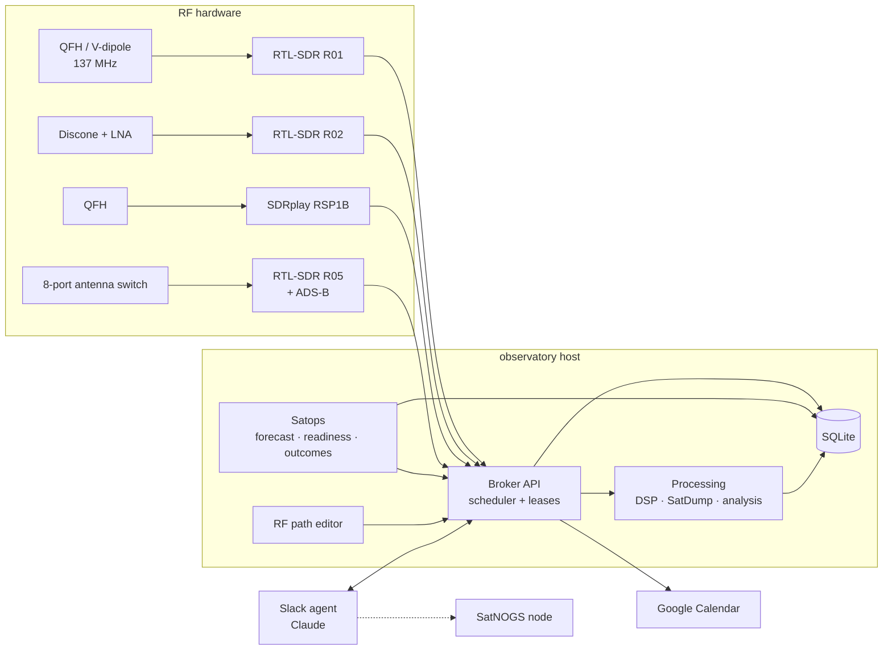

<p align="center"></p>

**An autonomous, receive-only home radio observatory.** Starlab schedules and records weather-satellite passes, shares a handful of SDR receivers between automatic and manual work without collisions, decodes and analyzes what it captures, and can be operated in plain English from Slack.

It runs on a single Linux box with a small fleet of RTL-SDR and SDRplay receivers, a few purpose-built antennas, and a network-controlled antenna switch.

> **Status:** beta (recommended version 0.9.0b1). Installable on Ubuntu, Debian and Raspberry Pi OS with one installer, a first-run setup wizard, and a simulation mode for trying it without any receiver. What is and isn't tested: **[release readiness](docs/release-readiness.md)**.

---

## What it does

- **Satellite operations.** Builds a rolling 72-hour forecast of METEOR-M weather-satellite passes, checks each pass against ten readiness checks (receiver present, antenna covers the band, enough disk, no conflicting process holding the dongle, fresh orbital data, and more), and tracks every pass through a state machine: `SCHEDULED → READY → RECORDING → RECORDED → DECODED`, or `FAILED` / `MISSED` with a recorded reason.
- **One scheduler for every receiver.** A broker service is the single reservation authority for all SDRs. Automatic passes, manual jobs, and windows from older recorders live in one table, locked per physical device serial. Booking is transactional, so two requests can never double-book a receiver.
- **Sensible priorities.** Satellite passes beat manual use, which beats background discovery. A manual job can preempt an automatic pass (and the pass is restored if the job is cancelled), but nothing ever interrupts a recording that's already running.
- **Decoding and analysis.** Recordings can be sent through SatDump, with the broker's own DSP stage shifting and decimating off-center signals first. Analysis tools produce waterfalls, noise-floor and clipping reports, and side-by-side comparisons of the same pass captured on different receivers.
- **Google Calendar sync.** Every planned recording appears on a shared calendar, set up from the web page (upload a key, test, turn on). Event IDs are deterministic, so a lost database never creates duplicate events, and passes that drop out of the forecast are flagged rather than left looking healthy.
- **Slack.** Optional notifications and a `/starlab` command, set up from the setup wizard. The original station also runs a Claude-powered Slack bot that can check status, book recordings, kick off decodes, upload images, and take a receiver for interactive listening, all through the same broker API and rules as everything else.
- **Use it from any browser.** Starlab runs on the box next to the radios; you use it from your laptop or phone, at home or, with Tailscale, from anywhere over HTTPS.
- **RF signal-path editor.** A drag-and-drop web page models how antennas, filters, amplifiers, the antenna switch, and receivers are actually wired. The scheduler validates jobs against that layout, and every save is versioned.

## Design principles

1. **Fail closed.** If schedule data is missing or stale, background work releases the receivers and readiness reports a warning instead of "ready."
2. **Never claim what wasn't verified.** A pass is only `RECORDED` with full-size files and ≥ 90% window coverage, and only `DECODED` when a decoder produces real image content. Every state change is logged with its reason, so any missed recording can be explained after the fact.
3. **Local first.** Everything works with no internet connection. SQLite on local NVMe is the operational store.
4. **Hands off what already works.** Existing recorder services are integrated read-only and migrated receiver by receiver (`legacy → shadow → broker`), with a side-by-side shadow comparison before anything is switched over.
5. **Receive only.** There is no transmit path anywhere in the system.

## Architecture



| Package | Role |
|---|---|
| `src/aobs/satellites` | Pass forecasting, readiness checks, outcome tracking |
| `src/aobs/scheduling` | Unified scheduler, capture, DSP, IQ health checks, SatDump processing, analysis, RF layout editor |
| `src/aobs/coordination` | Broker API, receiver leases, and the guard that clears receivers before passes |
| `src/aobs/calendar` | Idempotent Google Calendar rendering and sync |
| `src/aobs/hardware` | RTL-SDR inventory (by serial, never by USB index) and antenna-switch access |
| `src/aobs/db` | SQLAlchemy Core schema (portable SQLite → PostgreSQL) |
| `agent/obsagent` | Slack bot, slash commands, and a locked-down SatNOGS integration |

## Hardware

| Receiver | Hardware | Typical use |
|---|---|---|
| OBS-R01 | RTL-SDR (R820T) | METEOR passes on a 137 MHz V-dipole with a SAW-filtered LNA |
| OBS-R02 | RTL-SDR (R820T) | Wideband work on a discone with an external LNA |
| OBS-R05 | Nooelec NESDR SMArt v5 | ADS-B aircraft tracking, plus on-demand use through the antenna switch |
| RSP1B | SDRplay RSP1B | METEOR passes on a Diamond QFH antenna |

The broker validates every job against each receiver type's real limits (frequency range, legal sample rates, gain steps, bias tee) and rejects anything it can't honor instead of silently adjusting it.

## Getting started

**Requirements:** Ubuntu 24.04+, Debian 13 or 64-bit Raspberry Pi OS 13; Python 3.12+ with `python3-venv`. Receivers
are optional (simulation mode works without any); install `rtl-sdr`, SoapySDR modules or SatDump for the hardware and
decoding you want.

1. **Recommended: install [Tailscale](https://tailscale.com)** on the Starlab computer and on your laptop or phone
   (free for personal use). It gives Starlab a private HTTPS address you can open from anywhere, with no router
   changes:

   ```bash
   curl -fsSL https://tailscale.com/install.sh | sh && sudo tailscale up
   ```

2. **Install Starlab** on the computer the receivers are plugged into:

   ```bash
   git clone https://github.com/TommytheMonkey/starlab_observatory.git starlab && cd starlab
   sudo ./install.sh --udev
   ```

   It asks how you'll open the web page (from other computers on your network or over Tailscale, or only on this
   computer). If Tailscale is running, it also offers the HTTPS address.

3. **Open a sign-in link on your laptop.** The installer ends with one link per address, for example:

   ```
     Tailscale, HTTPS (recommended)  https://starlab.tail1234.ts.net/rf/login/…
     home network                    http://starlab.local:8751/rf/login/…
   ```

   The setup wizard opens: name and location, receivers, satellites, scheduling, and optional Slack and Google
   Calendar. Starlab answers only your private networks and Tailscale, and nothing records until you book a
   recording or enable a rule. For a new link later, run `starlab web-link` on that computer (or over SSH).

Full guides:

| Guide | |
|---|---|
| [Installation](docs/installation.md) | requirements, installer options, upgrading, uninstalling |
| [Opening Starlab from another computer](docs/remote-access.md) | Tailscale (recommended), home network, signing in, setting up SSH |
| [First-run setup](docs/first-run-setup.md) | the setup wizard step by step, simulation mode |
| [Receiver configuration](docs/receiver-configuration.md) | adding, identifying and verifying receivers |
| [Remote receivers](docs/remote-receivers.md) | receivers on other Linux computers over SSH |
| [Satellite scheduling](docs/satellite-scheduling.md) | passes, manual bookings, automatic rules |
| [Recordings and archive](docs/ARCHIVE.md) | outcomes, decoding, storage, retention |
| [Slack integration](docs/slack-integration.md) | optional notifications and `/starlab` commands |
| [Google Calendar](docs/google-calendar.md) | publishing recordings to a calendar from the web page |
| [Backup and restore](docs/backup-and-restore.md) | backups, export/import, rolling back an upgrade |
| [Troubleshooting](docs/troubleshooting.md) | error messages and what to do |

### The original station (developer setup)

This repository grew out of one station, which still runs from a git checkout with `config/observatory.toml` and the
`aobs` command (see [OPERATIONS](docs/OPERATIONS.md), [RUNBOOK](docs/RUNBOOK.md) and the
[release checklist](docs/release-checklist.md)):

```bash
python3 -m venv --system-site-packages .venv && .venv/bin/pip install -e .
aobs inventory                   # receivers, USB holders, antenna switch, leases (read-only)
aobs forecast                    # 72 h pass forecast with readiness
aobs broker                      # run the broker API
aobs schedule validate job.json  # dry-run a recording request
```

Its Slack bot (`agent/`) offers `/radio-*` commands and plain-English questions; see [COMMANDS](docs/COMMANDS.md).

## Documentation

| Doc | What's in it |
|---|---|
| [ARCHITECTURE](docs/ARCHITECTURE.md) | Principles, components, pass state machine, readiness checks |
| [SCHEDULER](docs/SCHEDULER.md) | Booking rules, priorities, hardware limits, job states, recorder migration |
| [COMMANDS](docs/COMMANDS.md) | Full Slack command reference and decoding details |
| [ARCHIVE](docs/ARCHIVE.md) | Recordings page: outcomes, decoder profiles, storage, transfer and retention |
| [Slack integration](docs/slack-integration.md) | Optional notifications and `/starlab` commands; manifest, credentials, security |
| [RF_PATHS](docs/RF_PATHS.md) | The signal-path editor and what a save changes |
| [DISCOVERY_ENGINE](docs/DISCOVERY_ENGINE.md) | Design for background RF scanning and signal discovery |
| [OPERATIONS](docs/OPERATIONS.md) · [RUNBOOK](docs/RUNBOOK.md) | Install, recovery, and day-to-day operation |
| [RTL_SDR](docs/RTL_SDR.md) | Notes on RTL-SDR software and receiver health |

## Roadmap

- [x] Environment inventory and satellite operations (forecast, readiness, outcomes, calendar)
- [x] Unified scheduler, broker API, and Slack agent
- [x] SatDump decoding, IQ health checks, and RF analysis
- [x] RF signal-path editor
- [x] Installer, first-run setup wizard, simulation mode, remote receiver hosts
- [x] Opening Starlab from any browser: home network, Tailscale HTTPS, sign-in links
- [ ] Background RF discovery: scan profiles, adaptive noise floor, signal clustering, novelty scoring
- [ ] Offloading classification and decoding to a GPU machine over Tailscale
- [ ] Rotator control and automatic recording for SoapySDR receivers

## Tests

```bash
.venv/bin/pip install pytest
.venv/bin/pytest
```

About 530 tests cover the scheduler, broker, forecasting, readiness, DSP, IQ health, calendar sync, the setup wizard,
integrations, web access and the Slack command layer. `tests/install/container-test.sh` runs the installer end to end
in a clean container.

## License

Starlab Observatory is released under the [MIT License](LICENSE).
