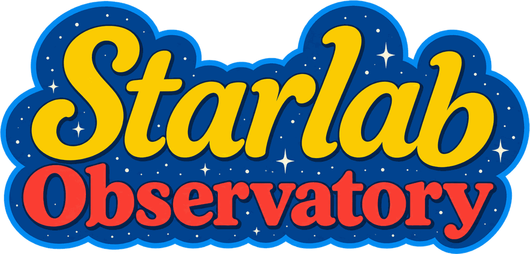
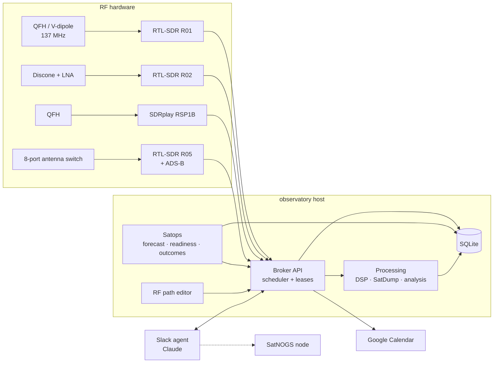

<p align="center"></p>

**An autonomous, receive-only home radio observatory.** Starlab schedules and records weather-satellite passes, shares a handful of SDR receivers between automatic and manual work without collisions, decodes and analyzes what it captures, and can be operated in plain English from Slack.

It runs on a single Linux box with a small fleet of RTL-SDR and SDRplay receivers, a few purpose-built antennas, and a network-controlled antenna switch.

> **Status:** active project, grown out of one specific station and becoming installable anywhere. See **[INSTALL.md](INSTALL.md)**: one installer for Debian, Ubuntu and Raspberry Pi OS, a first-run setup wizard, and a simulation mode for trying it without any receiver.

---

## What it does

- **Satellite operations.** Builds a rolling 72-hour forecast of METEOR-M weather-satellite passes, checks each pass against ten readiness checks (receiver present, antenna covers the band, enough disk, no conflicting process holding the dongle, fresh orbital data, and more), and tracks every pass through a state machine: `SCHEDULED → READY → RECORDING → RECORDED → DECODED`, or `FAILED` / `MISSED` with a recorded reason.
- **One scheduler for every receiver.** A broker service is the single reservation authority for all SDRs. Automatic passes, manual jobs, and windows from older recorders live in one table, locked per physical device serial. Booking is transactional, so two requests can never double-book a receiver.
- **Sensible priorities.** Satellite passes beat manual use, which beats background discovery. A manual job can preempt an automatic pass (and the pass is restored if the job is cancelled), but nothing ever interrupts a recording that's already running.
- **Decoding and analysis.** Recordings can be sent through SatDump, with the broker's own DSP stage shifting and decimating off-center signals first. Analysis tools produce waterfalls, noise-floor and clipping reports, and side-by-side comparisons of the same pass captured on different receivers.
- **Google Calendar sync.** Every planned recording appears on a shared calendar. Event IDs are deterministic, so a lost database never creates duplicate events, and passes that drop out of the forecast are flagged rather than left looking healthy.
- **A Slack radio operator.** A Claude-powered Slack bot can check status, book recordings, kick off decodes, upload images, and take a receiver for interactive listening, all through the same broker API and rules as everything else.
- **RF signal-path editor.** A drag-and-drop web page models how antennas, filters, amplifiers, the antenna switch, and receivers are actually wired. The scheduler validates jobs against that layout, and every save is versioned.

## Design principles

1. **Fail closed.** If schedule data is missing or stale, background work releases the receivers and readiness reports a warning instead of "ready."
2. **Never claim what wasn't verified.** A pass is only `RECORDED` with full-size files and ≥ 90% window coverage, and only `DECODED` when a decoder produces real image content. Every state change is logged with its reason, so any missed recording can be explained after the fact.
3. **Local first.** Everything works with no internet connection. SQLite on local NVMe is the operational store.
4. **Hands off what already works.** Existing recorder services are integrated read-only and migrated receiver by receiver (`legacy → shadow → broker`), with a side-by-side shadow comparison before anything is switched over.
5. **Receive only.** There is no transmit path anywhere in the system.

## Architecture



| Package | Role |
|---|---|
| `src/aobs/satellites` | Pass forecasting, readiness checks, outcome tracking |
| `src/aobs/scheduling` | Unified scheduler, capture, DSP, IQ health checks, SatDump processing, analysis, RF layout editor |
| `src/aobs/coordination` | Broker API, receiver leases, and the guard that clears receivers before passes |
| `src/aobs/calendar` | Idempotent Google Calendar rendering and sync |
| `src/aobs/hardware` | RTL-SDR inventory (by serial, never by USB index) and antenna-switch access |
| `src/aobs/db` | SQLAlchemy Core schema (portable SQLite → PostgreSQL) |
| `agent/obsagent` | Slack bot, slash commands, and a locked-down SatNOGS integration |

## Hardware

| Receiver | Hardware | Typical use |
|---|---|---|
| OBS-R01 | RTL-SDR (R820T) | METEOR passes on a 137 MHz V-dipole with a SAW-filtered LNA |
| OBS-R02 | RTL-SDR (R820T) | Wideband work on a discone with an external LNA |
| OBS-R05 | Nooelec NESDR SMArt v5 | ADS-B aircraft tracking, plus on-demand use through the antenna switch |
| RSP1B | SDRplay RSP1B | METEOR passes on a Diamond QFH antenna |

The broker validates every job against each receiver type's real limits (frequency range, legal sample rates, gain steps, bias tee) and rejects anything it can't honor instead of silently adjusting it.

## Getting started

**Requirements:** Linux, Python 3.12+, `rtl-sdr` tools, and the scientific stack (`skyfield`, `sgp4`, `numpy`, `scipy`) from your system packages. SatDump is optional, for decoding.

```bash
git clone https://github.com/TommytheMonkey/starlab_observatory.git
cd starlab_observatory
python3 -m venv --system-site-packages .venv
.venv/bin/pip install -e .
```

Edit `config/observatory.toml` for your receivers, antennas, and paths. Secrets (OAuth clients, tokens, webhooks) never go in that file; they live in a separate secrets directory that the code refuses to use if it's group- or world-readable.

### Everyday commands

```bash
aobs inventory                   # receivers, USB holders, antenna switch, leases (read-only)
aobs forecast                    # 72 h pass forecast with readiness
aobs readiness --limit 3         # every check for the next passes, with evidence
aobs calendar plan --show 2      # preview calendar events (no writes)
aobs broker                      # run the broker API
aobs schedule validate job.json  # dry-run a recording request
```

Add `--config path/to/observatory.toml` to point at a specific config. Example systemd units live in `deploy/`.

### From Slack

```
/radio-status                         # live state of receivers, jobs, storage, services
/radio-schedule dry-run {"jobs": [...]}
/radio-recordings latest
/radio-decode recording=<id>
/radio-waterfall recording=<id> frequency=137.9 bandwidth=250000
/radio-results <id> type=images
```

Or just DM the bot: *"what's the next METEOR pass, and is everything ready for it?"*

## Documentation

| Doc | What's in it |
|---|---|
| [ARCHITECTURE](docs/ARCHITECTURE.md) | Principles, components, pass state machine, readiness checks |
| [SCHEDULER](docs/SCHEDULER.md) | Booking rules, priorities, hardware limits, job states, recorder migration |
| [COMMANDS](docs/COMMANDS.md) | Full Slack command reference and decoding details |
| [ARCHIVE](docs/ARCHIVE.md) | Recordings page: outcomes, decoder profiles, storage, transfer and retention |
| [RF_PATHS](docs/RF_PATHS.md) | The signal-path editor and what a save changes |
| [DISCOVERY_ENGINE](docs/DISCOVERY_ENGINE.md) | Design for background RF scanning and signal discovery |
| [OPERATIONS](docs/OPERATIONS.md) · [RUNBOOK](docs/RUNBOOK.md) | Install, recovery, and day-to-day operation |
| [RTL_SDR](docs/RTL_SDR.md) | Notes on RTL-SDR software and receiver health |

## Roadmap

- [x] Environment inventory and satellite operations (forecast, readiness, outcomes, calendar)
- [x] Unified scheduler, broker API, and Slack agent
- [x] SatDump decoding, IQ health checks, and RF analysis
- [x] RF signal-path editor
- [ ] Background RF discovery: scan profiles, adaptive noise floor, signal clustering, novelty scoring
- [ ] Offloading classification and decoding to a GPU machine over Tailscale
- [ ] Web dashboard and notifications

## Tests

```bash
.venv/bin/pip install pytest
.venv/bin/pytest
```

About 200 tests cover the scheduler, broker, forecasting, readiness, DSP, IQ health, calendar sync, and the Slack command layer.

## License

Starlab Observatory is released under the [MIT License](LICENSE).
