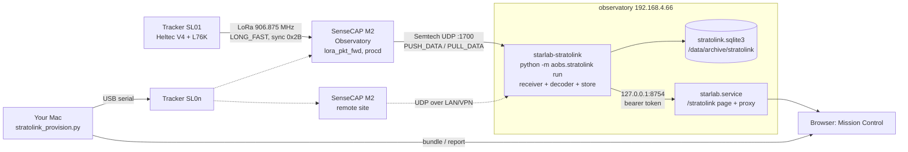

# Stratolink

Balloon tracking for Starlab: Meshtastic trackers (Heltec V4 + L76K first) heard by receive-only SenseCAP M2 US915
gateways running a custom packet forwarder, decoded on the observatory and shown on Starlab's **Stratolink** page.

| Guide | |
|---|---|
| [Deploying and switching over](deploy.md) | systemd service, moving off the manual `receiver.py`, upgrades |
| [Firmware](firmware.md) | the archived SenseCAP M2 image, how it was built, rebuilding it |
| [Ground stations](ground-stations.md) | adding a SenseCAP M2: flash, trust, inspect, deploy, verify, rollback |
| [Trackers](trackers.md) | provisioning a tracker from your Mac, discovery, registration, private channels |
| [Profiles](profiles.md) | Ground Test, High-Altitude Flight, Long-Duration Pico, editing and validation |
| [Packet decoding](protocol.md) | Semtech UDP, the Meshtastic header, AES-CTR, the protobufs, dedup rules |
| [Recovery](recovery.md) | gateway, service and database recovery |
| [Troubleshooting](troubleshooting.md) | symptoms and what to check |
| [Adding hardware](adding-hardware.md) | supporting another tracker board or gateway |

## Architecture



* **Receive only, end to end.** The gateways' radios have `tx_enable: false`; the server answers only PUSH_ACK and
  PULL_ACK and never sends PULL_RESP (downlink).
* **The daemon is a companion service**, like the SSTV and pirate watches: own SQLite store, own systemd unit (user
  tommy), a control endpoint on 127.0.0.1 that `starlab.service` forwards to behind its sign-in. It leases no
  receiver and never touches the scheduler, so recordings and SDR scheduling are unaffected. It is capped at nice 5,
  CPU weight 50 and 512 MB.
* **One owner of UDP 1700.** The socket is bound to the LAN address only (never 0.0.0.0), without SO_REUSEADDR/PORT:
  while anything else holds the port the daemon reports `port_busy` and retries; it never splits the traffic.
  Datagrams from addresses outside `allowed_sources` (or a registered station's address) are dropped unanswered.
* **Live updates** use Starlab's existing pattern (polling through the broker, like the other pages; Starlab has no
  WebSocket/SSE): the page asks `/v1/stratolink/live?after=<id>` every 2 s and gets only new receptions.
* **Nothing is fabricated.** A value that was not received is shown as "—" with the reason. GPS fixes (green, they
  move the balloon and extend the track) are distinct from other packets (blue ripple only). Rejected fixes are kept
  with the reason and never drawn.

## Data

`/data/archive/stratolink/`

| Path | |
|---|---|
| `stratolink.sqlite3` | receptions, packets, positions, telemetry, nodes, gateways, gateway status, trackers, flights, preflight |
| `profiles/*.json` | editable tracker profiles |
| `provision/` | provisioning bundles and reports |
| `gateway-config/` | captured radio template, per-deploy gateway backups |
| `firmware/<release>/` | archived ground-station firmware, `RELEASE.json`, `SHA256SUMS` |
| `firmware/source-mirror/` | every source tarball and the OpenWrt tree/feeds at their commits (offline rebuilds) |
| `status.json` | the receiver's state, every 5 s |

`~/.config/starlab/stratolink.toml` (settings) and `~/.config/starlab/stratolink-keys.toml` (private channel keys,
mode 600; the daemon refuses it otherwise).

### Privacy

Every node on the public mesh is decoded and listed under **Discovered nodes**, but only registered trackers get a
position history. Other nodes keep a position rounded to ~1 km (`foreign_position_decimals`), and the raw frames of
their packets are dropped after 24 h (`raw_retention_h`). Register only your own trackers.

## Command line

```bash
cd ~/starlab-dev
.venv/bin/python -m aobs.stratolink status            # receiver, stations, trackers
.venv/bin/python -m aobs.stratolink packets --limit 20
.venv/bin/python -m aobs.stratolink decode <hex>       # decode one frame
.venv/bin/python -m aobs.stratolink import [paths]     # import packets.jsonl (idempotent)
.venv/bin/python -m aobs.stratolink flight list|create|start|end
.venv/bin/python -m aobs.stratolink tracker list|register
.venv/bin/python -m aobs.stratolink gateway trust|inspect|capture|deploy|rollback|verify|flash|register
.venv/bin/python -m aobs.stratolink firmware           # archived images, checksums re-verified
```

Tests: `tests/test_stratolink.py` (the verified RF packet `ffffffff94fb61f6…` is the regression test).
